# Dimensionality reduction and an ensemble of LSTMs for antimicrobial resistance prediction

[](https://doi.org/10.1016/j.artmed.2023.102508)
[%20102508-173f5f)](https://doi.org/10.1016/j.artmed.2023.102508)
[](https://www.python.org/)
[](LICENSE)

Companion code for Hernández-Carnerero et al., *Artificial Intelligence in Medicine* **138** (2023) 102508.
The study predicts whether *Pseudomonas aeruginosa* cultured in an intensive care unit will be **resistant or susceptible** to **six antibiotic families**, using the days of electronic health record data that precede the culture.

The antibiogram usually takes about **48 hours**. The model reads the **30 days** before the culture and returns an early estimate for each of those six families: **aminoglycosides (AMG)**, **carbapenems (CAR)**, **fourth-generation cephalosporins (CF4)**, **extended-spectrum penicillins (PAP)**, **polymyxins (POL)** and **quinolones (QUI)**.

<p align="center">
  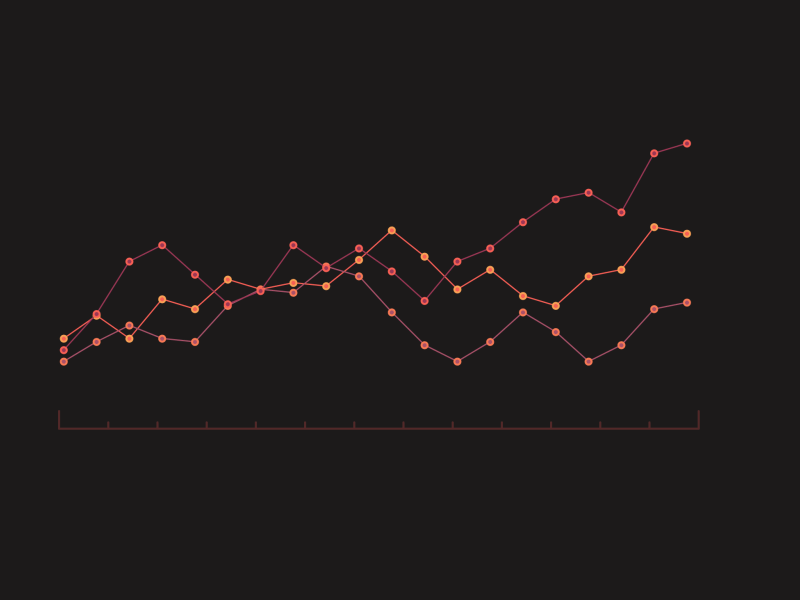
</p>

<p align="center"><i>A <b>multivariate time series</b> is several variables observed on the same clock. In this study each line would be one clinical variable, and each step would be one day in the ICU.</i></p>

<p align="center">
  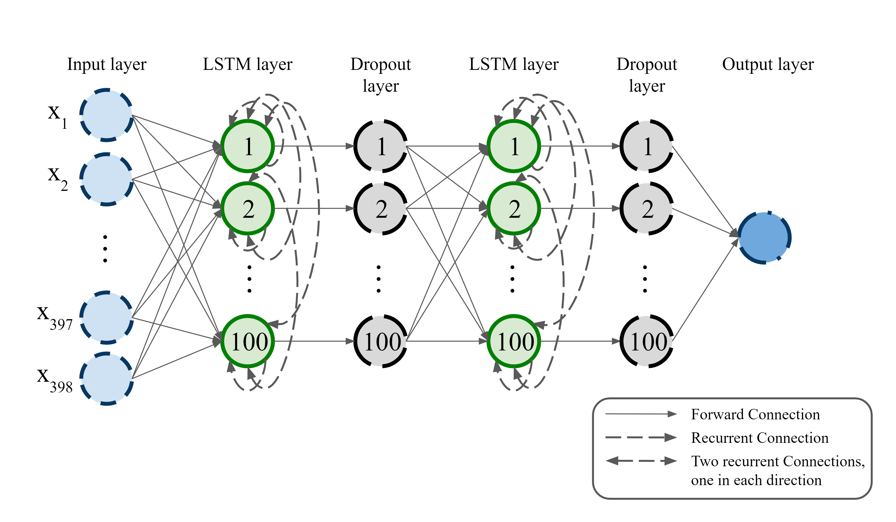
</p>

<p align="center"><i>Network used in the study. Each LSTM layer has 100 units on the full feature set and 50 units after feature selection. The activation function is ReLU, dropout is 0.2, and the output is a sigmoid trained with binary cross-entropy and RMSprop.</i></p>

## What one culture looks like

Each culture is a **multivariate time series** of **30 days** and **398 features**. A **positive** label is a resistant result.

Three **indicator features** — one for admission, one for cultures, and one for the co-admitted ICU patients — record whether that block applies on a given day. When an indicator is off, the other features in its block are **don't-care** values, coded as **−1**, outside the normalized range. The same code fills the days before the ICU stay. The figure below shows one indicator and the don't-care cells it governs.

<p align="center">
  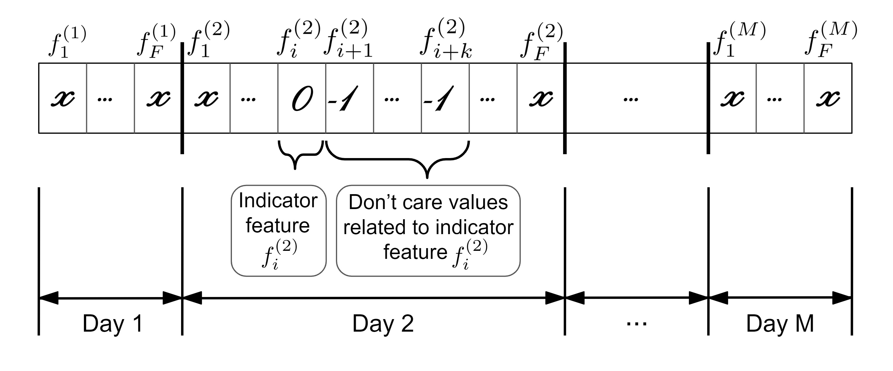
</p>

Features fall into nine sets published with the paper:

| Set | What it records | Columns |
| --- | --- | ---: |
| Temporal | Day of week, day of month, month | 3 |
| Admission | Origin, destination, reason, category, age, sex | 64 |
| Culture | Sample type and which antibiotics were tested | 112 |
| Prior resistance | Earlier *P. aeruginosa* results for this patient | 7 |
| Treatment | Antibiotics administered, mechanical ventilation | 50 |
| Co-admitted patients | How many other patients share the ICU that day | 1 |
| ICU admission | The same admission descriptors, pooled over co-admitted patients | 93 |
| ICU resistance | Resistance observed in co-admitted patients | 7 |
| ICU treatment | Antibiotics and ventilation among co-admitted patients | 61 |

`date` and `year` are left out. They impose an order on the cultures and, in earlier work on this task, made prediction worse.

Cultures are sorted in time. **Training** uses 2004–2012. From 2013–2019, the earlier half is **validation** and the later half is **test**. A patient who appears in training is removed from both later sets, so the same stay cannot leak into the evaluation.

## The method

Three wrapper importances are computed with the **LSTM** itself, so the score of a feature depends on the sequence model that will use it.

<p align="center">
  
  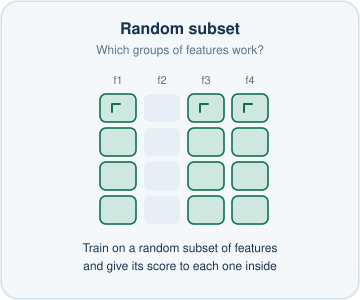
  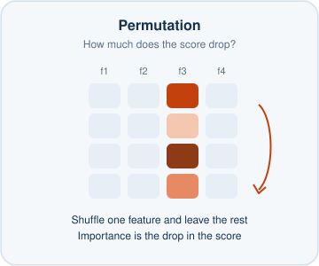
</p>

1. **Gradient feature importance.** For each validation culture, the input gradient is averaged over the 30 days and squared. Fifty trainings are averaged, weighted by the validation **evaluation metric**.
2. **Random-subset feature importance.** Five hundred subsets of 40 features are drawn. A feature's score is the mean validation metric of the subsets that contain it.
3. **Permutation feature importance.** After one training, each feature is shuffled on the validation set. The score is how far the metric falls. This is repeated 50 times.

The **evaluation metric** is the mean of **accuracy**, **sensitivity** and **specificity**. Sensitivity is the accuracy on resistant cultures and specificity is the accuracy on susceptible cultures. The three importance scores are scaled to [0, 1] and averaged, and the features are sorted by that average.

The number of features to keep is not chosen by eye. A network is trained on the top 1, 2, … features, and each size receives a **performance value**:

`performance = mean(accuracy, sensitivity, specificity) − std(accuracy, sensitivity, specificity)`.

A **recursive split** keeps the half of the range with the higher mean performance and stops when the surviving interval is shorter than 10. The right edge of that interval is the number of features.

<p align="center">
  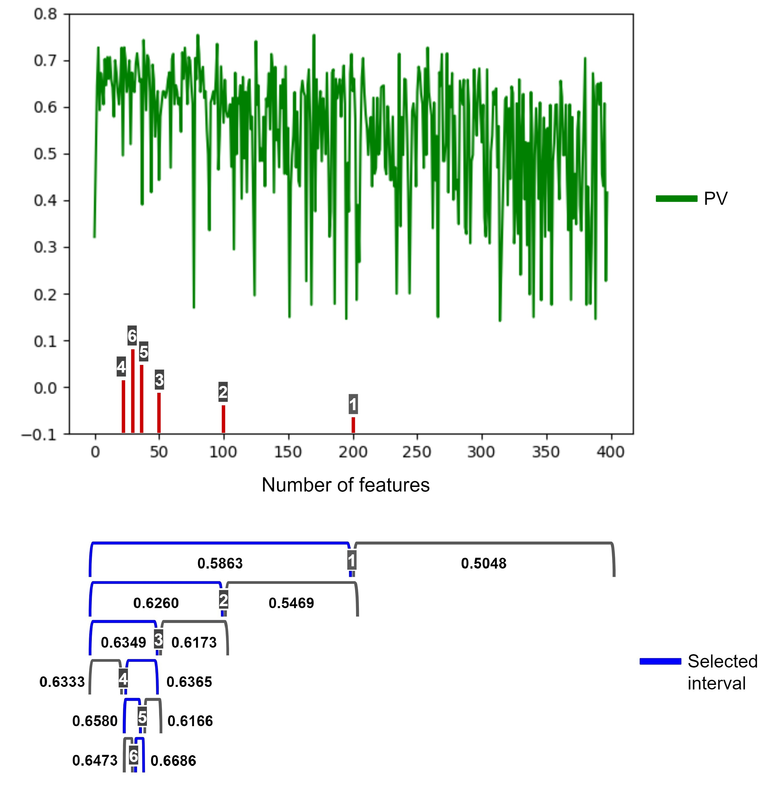
</p>

High dimensionality is only half of the difficulty: each family has a few hundred training cultures, and a single initialization moves the metrics. The **horizontal voting ensemble** stores the network after every epoch from 11 to 30 (20 checkpoints) and averages their probabilities. The single-network baseline is the checkpoint at epoch 20. Because the ensemble reuses one training run, it does not multiply the cost of fitting the LSTM from scratch.

Two published feature selectors are included for comparison.

- **Bootstrap voting** tests, on each day, whether the mean of a feature differs between resistant and susceptible cultures. Padding and don't-care days are left out of the vote. A feature is kept when it wins a majority of the days that can be tested. Each test uses the budget stated in the paper: 2,000 bootstrap draws of 70% of each class, at 95% confidence.
- **Group lasso** fits a logistic model in which the 30 time steps of a feature are one group and are shrunk together. The penalty is chosen on the validation **evaluation metric**.

## What the study found

Across **15 years** at the University Hospital of Fuenlabrada the **resistant fraction tends to rise**, and the recent years contain fewer cultures. That shift is the **concept drift** of this task: the same EHR features do not point at the same class forever, because the bacteria keep changing and that change is not itself a column in the record. The features built for the study offset part of this drawback. **Previous resistance of the same patient** is especially useful: a recent antibiogram still informs the next one, which is what the selection results show.

<p align="center">
  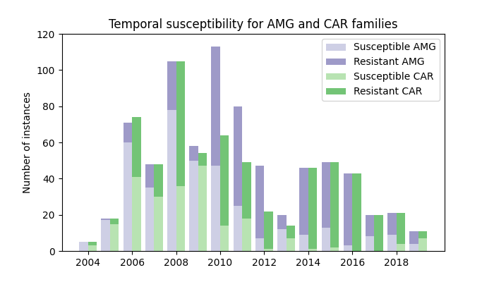
</p>
<p align="center">
  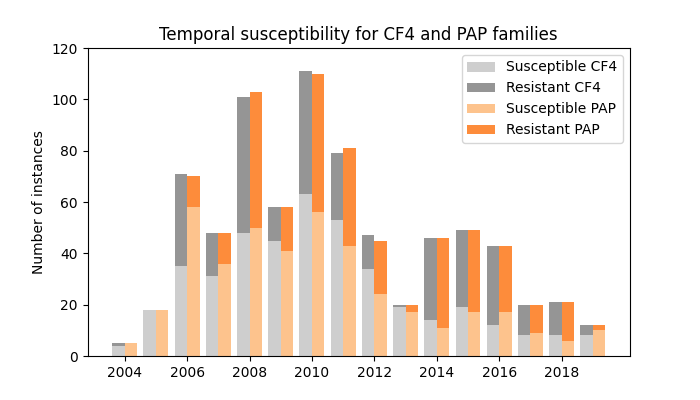
</p>
<p align="center">
  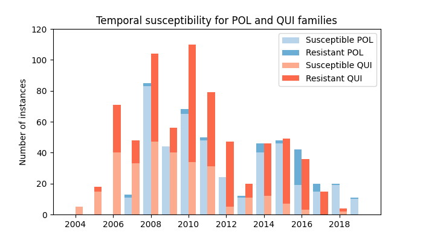
</p>

The proposed feature selector cuts **398 features** down to a few dozen. In each row, the **smallest** subset is in bold.

<table align="center">
  <thead>
    <tr>
      <th>Family</th>
      <th align="right">Proposed</th>
      <th align="right">Bootstrap voting</th>
      <th align="right">Group lasso</th>
    </tr>
  </thead>
  <tbody>
    <tr><td>AMG</td><td align="right"><b>36</b></td><td align="right">99</td><td align="right">61</td></tr>
    <tr><td>CAR</td><td align="right"><b>18</b></td><td align="right">94</td><td align="right">96</td></tr>
    <tr><td>CF4</td><td align="right"><b>67</b></td><td align="right">86</td><td align="right">100</td></tr>
    <tr><td>PAP</td><td align="right"><b>24</b></td><td align="right">56</td><td align="right">103</td></tr>
    <tr><td>POL</td><td align="right">55</td><td align="right">46</td><td align="right"><b>41</b></td></tr>
    <tr><td>QUI</td><td align="right"><b>49</b></td><td align="right">187</td><td align="right">93</td></tr>
  </tbody>
</table>

The columns that survive are dominated by the patient's own **admission**, the **antibiotics** given during the stay, and **previous resistance** in that same patient. Ciprofloxacin, colistin, sex, acute respiratory failure and prior quinolone resistance are among the features selected for several families. That pattern matches **antibiotic selective pressure**: the drugs that clear susceptible organisms leave the resistant ones. Co-admitted-patient counts and ICU-level resistance were not selected for any family.

<p align="center">
  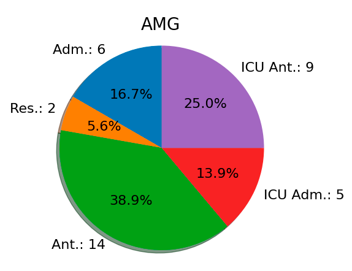
  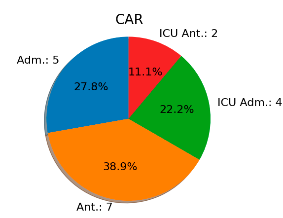
  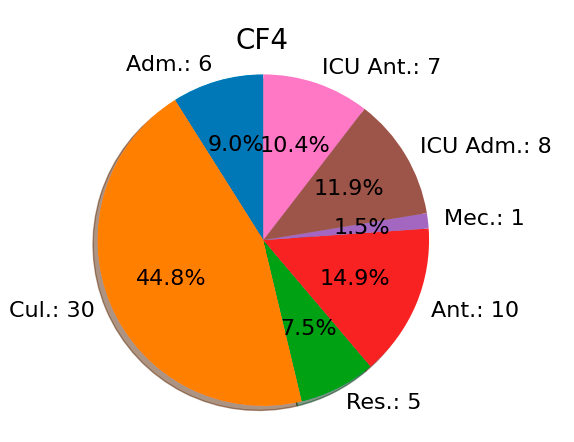
</p>
<p align="center">
  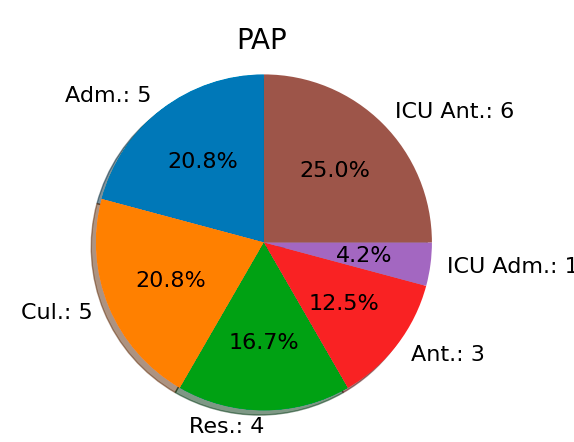
  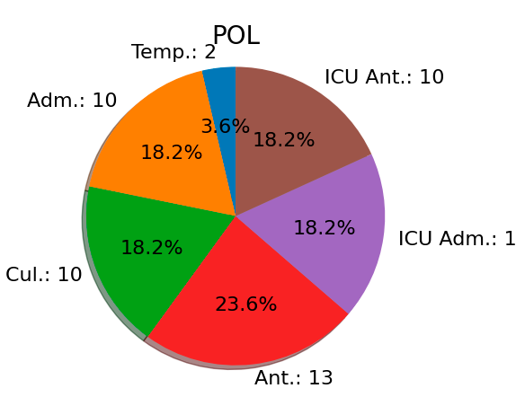
  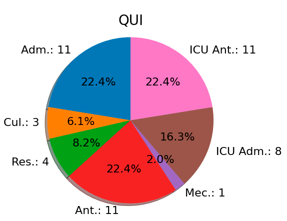
</p>

On the held-out years, feature selection raises **test AUC** for five of the six families and lowers the loss in every family. The ensemble then adds a smaller, consistent gain. **POL** remains the difficult family: the training set contains **9 resistant cultures**, and the network predicts the susceptible class.

<p align="center"><b>Test AUC (%)</b>, mean over 50 initializations.</p>

<table align="center">
  <thead>
    <tr>
      <th>Family</th>
      <th align="right">All 398 features</th>
      <th align="right">Proposed subset</th>
      <th align="right">Subset + ensemble</th>
    </tr>
  </thead>
  <tbody>
    <tr><td>AMG</td><td align="right">60.2</td><td align="right"><b>76.6</b></td><td align="right"><b>76.8</b></td></tr>
    <tr><td>CAR</td><td align="right"><b>68.9</b></td><td align="right">65.9</td><td align="right">66.5</td></tr>
    <tr><td>CF4</td><td align="right">58.0</td><td align="right"><b>62.8</b></td><td align="right"><b>63.5</b></td></tr>
    <tr><td>PAP</td><td align="right">63.7</td><td align="right"><b>71.2</b></td><td align="right"><b>71.6</b></td></tr>
    <tr><td>POL</td><td align="right">37.1</td><td align="right"><b>41.6</b></td><td align="right"><b>42.3</b></td></tr>
    <tr><td>QUI</td><td align="right">75.3</td><td align="right"><b>88.1</b></td><td align="right"><b>89.4</b></td></tr>
  </tbody>
</table>

A paired bootstrap test (2,000 resamples, 70% of the 50 runs, α = 0.05) finds a significant test-set improvement for the proposed subset in every family except CAR, where the full feature set has the higher AUC. The ensemble improves the test AUC significantly in every family. Validation loss for AMG starts to rise after epoch 20 while training loss keeps falling, which is why training stops there when the ensemble is not used.

<p align="center">
  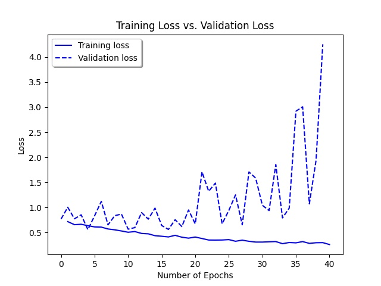
</p>

The predictions estimate the laboratory antibiogram. They are not a substitute for it, and they are not a device for choosing a drug at the bedside. A clinician can use them as one more piece of information while the culture is still in the laboratory.

## Run the code

Python 3.10, 3.11, 3.12 or 3.13. TensorFlow does not publish wheels for 3.14.

```bash
python -m venv .venv
source .venv/bin/activate          # Windows: .venv\Scripts\activate
pip install -e ".[dev]"
pytest
python -m amr_lstm.demo
```

The demo builds a synthetic cohort (about 40 columns, a few dozen patients), runs all three importance methods, the recursive cutoff, bootstrap voting and group lasso, fits the horizontal ensemble, and writes `outputs/demo_selection.png`. It finishes in a few minutes on a CPU. The numbers it prints belong to that synthetic draw.

`StudyConfig.paper()` holds the published budget: 100 units, 20 epochs, 50 / 500 / 50 importance repetitions, a curve over every feature, and 50-unit models for the selected subset and the ensemble. Walking that curve for one family means training the LSTM once per feature, on top of the importance stage. Six families at that budget are a cluster job, which is how the paper was computed.

```python
from amr_lstm.config import StudyConfig
from amr_lstm.data import temporal_split
from amr_lstm.pipeline import select_features
from amr_lstm.synthetic import generate_cohort

cohort = generate_cohort(n_patients=80, seed=0)
split = temporal_split(cohort, "qui", year_split=2012, seed=0)
result = select_features(split, cohort.feature_names, StudyConfig.demo(), seed=0)
print(result.n_features, result.proposed.feature_names)
```

Bring your own cohort as an `.npz` with `x` shaped `(n, 30, n_features)`, `y` shaped `(n, 6)` (`NaN` where a family was not tested), plus `year`, `patient_id`, `order` and `feature_names`. `amr_lstm.data.load_cohort` reads that file. Column names and order for the 398-feature matrix are `amr_lstm.schema.FEATURES`.

```
src/amr_lstm/
  schema.py        398 columns and the nine feature sets
  synthetic.py     cohort generator
  data.py          temporal, patient-independent split
  model.py         stacked LSTM, RMSprop, input gradients
  importance.py    gradient, random subset, permutation, average
  selection/       recursive choice of how many features to keep
  baselines.py     bootstrap voting and group lasso
  training.py      forward curve and horizontal voting ensemble
  pipeline.py      one family, end to end
  stats.py         paired bootstrap interval on AUC
  published.py     tables reported in the paper
  demo.py          short runnable path
```

## Data

The cultures behind the paper come from the ICU of the University Hospital of Fuenlabrada, July 2004 to May 2019: 764 *P. aeruginosa* cultures from 277 patients. The hospital's ethics committee treats these records as confidential, including derived matrices, and this repository does not contain them.

`generate_cohort` builds a synthetic cohort with the same tensor shape, the same don't-care code, the same six targets and a resistance mechanism planted on prior resistance, a few administered antibiotics, sex, respiratory admission and mechanical ventilation, with resistance becoming more common in later years. It is a way to execute the code. It is not a statistical stand-in for the hospital, and a model trained on it says nothing about a real ICU.

## Citation

```bibtex
@article{hernandez2023dimensionality,
  title   = {Dimensionality reduction and ensemble of {LSTMs} for antimicrobial resistance prediction},
  author  = {Hern{\'a}ndez-Carnerero, {\`A}lvar and S{\`a}nchez-Marr{\`e}, Miquel
             and Mora-Jim{\'e}nez, Inmaculada and Soguero-Ruiz, Cristina
             and Mart{\'\i}nez-Ag{\"u}ero, Sergio and {\'A}lvarez-Rodr{\'\i}guez, Joaqu{\'\i}n},
  journal = {Artificial Intelligence in Medicine},
  volume  = {138},
  pages   = {102508},
  year    = {2023},
  doi     = {10.1016/j.artmed.2023.102508}
}
```

The result charts are reproduced from that article. The time-series animation and the three importance diagrams were made for this repository.

The code is released under the [MIT license](LICENSE). The article itself remains with the publisher.
